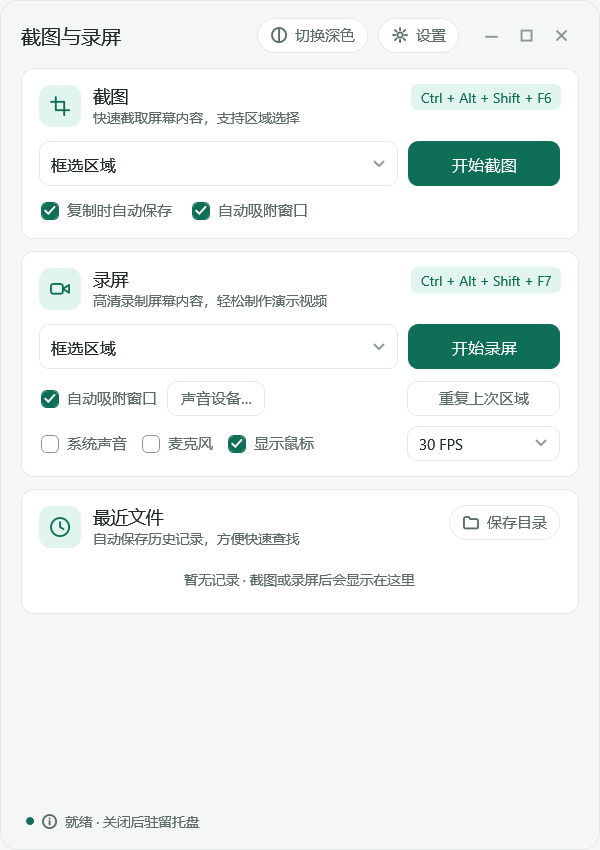
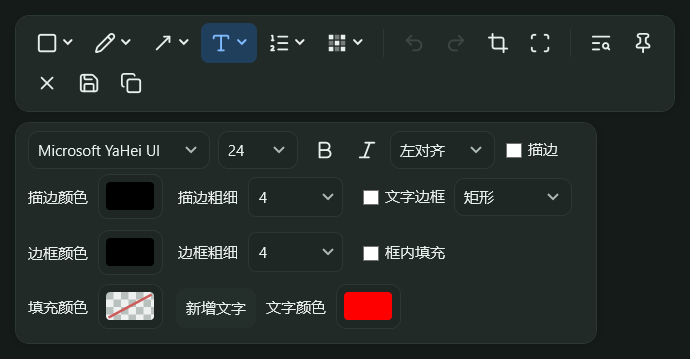
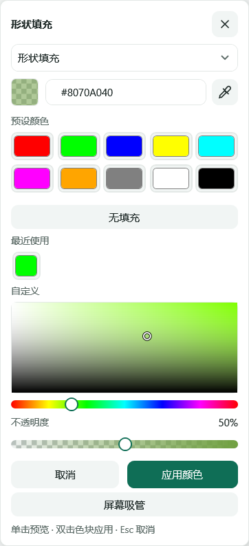
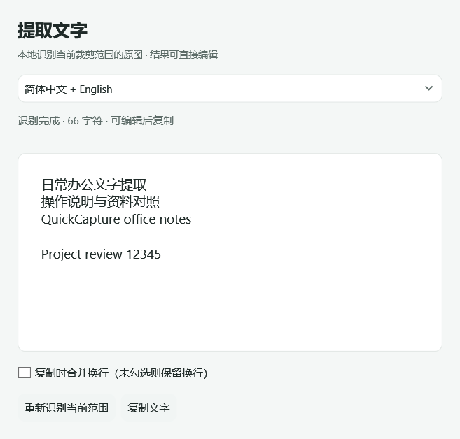
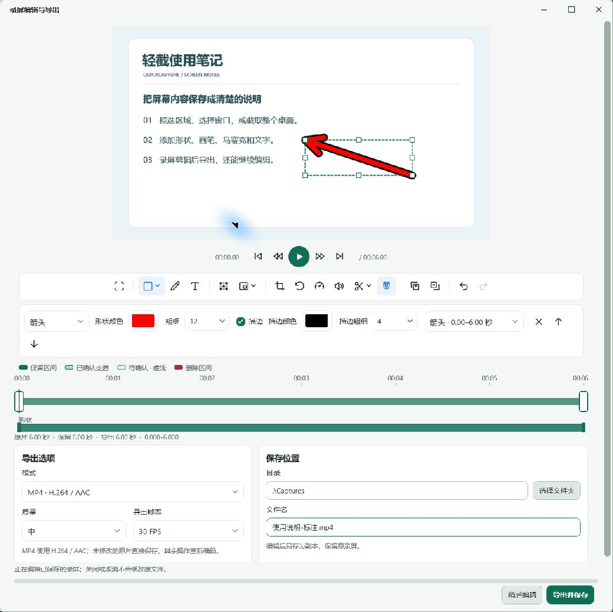
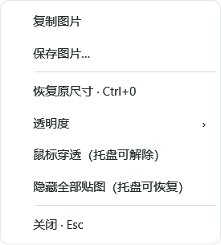
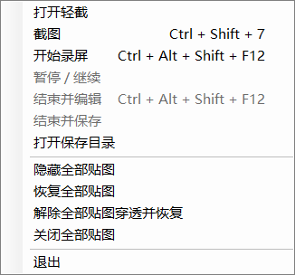

# 轻截 · QuickCapture

轻截是一款 Windows 截图与录屏工具。截图后直接标注、提取文字或置顶对照；录屏结束后剪辑和导出，并通过最近文件继续编辑。

## 主要功能

- **截图与标注**：区域、窗口和整个桌面截图；支持箭头、形状、涂鸦、马赛克、文字、步骤编号、裁剪与撤销重做。形状本体与描边、画笔本体与描边分别调节；文字支持粗体、斜体与描边，粗细可选常用值或自定义。马赛克支持框选和画笔模式。调色盘支持常用纯色、自定义颜色、透明度、画布与屏幕吸管，可预览后应用或取消。
- **本地文字识别**：提取简体中文、繁体中文和英文，可编辑、复制识别结果，无需联网。
- **置顶贴图**：缩放图片、调整透明度、开启鼠标穿透，方便与其他窗口对照。
- **录屏与声音**：区域、窗口和显示器录制，支持选区后立即开始或点击开始、暂停继续、系统声音与麦克风，可选择声音设备。
- **视频编辑**：首尾截取、多段删除、区间变速、画面裁剪与静音；添加矩形、圆角矩形、椭圆、箭头、线条、画笔、多行文字、马赛克及图片或视频画中画。箭头、线条和画笔的本体与描边分别设置颜色、透明度和粗细；文字支持粗体、斜体、字形描边与独立文字边框。画中画可置于四角或中心。支持图层调整、时间轴吸附、撤销重做、逐帧预览及保存后继续编辑。
- **日常使用**：最近文件、可配置全局快捷键、显示当前快捷键的托盘菜单、浅色与深色主题；截图保存为 PNG / JPG / WebP / BMP，视频导出为 MP4 / WebM / GIF。

## 界面预览

**截图文字标注**：字体、描边、文字边框与填充分别设置，属性按功能组自动换行。

<table>
<tr><th>颜色与透明度</th><th>本地文字识别</th></tr>
<tr>
<td align="center" valign="top"></td>
<td align="center" valign="top"></td>
</tr>
<tr><td>在调色面板中预览、取色，再应用颜色。</td><td>识别截图中的文字，编辑后直接复制。</td></tr>
</table>

**视频编辑**：在暂停画面上添加标注，通过时间轴调整生效区间，再选择格式导出。

<table>
<tr><th>置顶贴图</th><th>托盘与快捷键</th></tr>
<tr>
<td align="center" valign="top"></td>
<td align="center" valign="top"></td>
</tr>
<tr><td>调整透明度或鼠标穿透，方便桌面对照。</td><td>菜单显示当前绑定；快捷键可在设置中修改。</td></tr>
</table>

## 开始使用

1. **截图**：选择模式并点击“开始截图”，框选后使用浮动工具栏标注，复制或保存结果。按 `T` 添加文字，按 `O` 提取文字。
2. **录屏**：选择录制范围和声音选项，点击“开始录屏”，按设置立即录制或进入准备状态后点击“开始”。控制条可暂停、继续、“结束并编辑”或按默认设置“结束并保存”。编辑时调整保留范围；删除使用红色边界，区间变速使用青绿色区间，虚线表示待确认，选择倍率后确认。磁铁开关控制吸附，按住 `Alt` 临时关闭。完成后选择格式导出。
3. **继续编辑**：从最近文件的更多菜单打开截图或录屏编辑，也可打开文件及其所在目录。视频对象在暂停画面上绘制；选中后拖动、缩放并设置属性，通过时间轴轨道与边界手柄调整生效时间。按 `T` 后点击视频输入文字，双击文字可重新编辑，`Ctrl+Enter` 完成输入；在属性栏调整字体和描边，通过文字框四角和四边的八个手柄调整尺寸，宽度变化时自动换行并保持字号。画中画视频默认静音，素材结束即消失，素材及原片随编辑项目保留。

文字支持多处独立添加，完成一段后可继续添加；“新增文字”可在已有文字附近新建。文字边框与字形描边分别设置，边框可选矩形或圆角矩形，颜色、粗细和框内填充独立调节。录屏可添加多个图片或视频画中画，每段文字与每个小窗都有独立时间轴区间和图层。

颜色统一通过属性栏的颜色显示框打开调色盘调整。使用吸管时，在画面上的取色位置左键单击，再回到调色盘点击“应用颜色”；随后重新按下鼠标即可开始绘制。按 `Esc` 或右键取消取色，颜色草稿仍可继续调整。

默认全局快捷键为 `Ctrl+Alt+F8` 截图、`Ctrl+Alt+F9` 开始或结束录屏，可在设置中修改；以主界面和托盘右键菜单显示的当前组合为准。录制准备状态下，录屏快捷键开始当前录制；录制中再次按下会结束并打开编辑器。

关闭主窗口后程序驻留托盘，双击图标重新显示。右键菜单可截图、录屏、暂停继续、结束并编辑或保存、打开保存目录、集中管理贴图，以及退出程序。

## 获取与运行

在 [GitHub 发布页](https://github.com/Xhonesty/QuickCapture/releases) 查看可下载的软件包；[源码仓库](https://github.com/Xhonesty/QuickCapture)提供项目源码。

- **便携版**：下载发布页的 `QuickCapture-win-x64.zip`，完整解压后运行 `QuickCapture.exe`，保留同目录的运行文件；程序目录需要可写。
- **安装版**：下载发布页的 `QuickCapture-Setup-…-x64.exe`，按提示完成安装，从开始菜单启动。升级和卸载保留用户数据。

软件包包含 .NET 运行时、媒体工具与本地 OCR 模型，无需安装开发 SDK。支持 **Windows 10 22H2 / Windows 11，x64**；需要 Microsoft Visual C++ 2015–2022 x64 运行库，Windows N / KN 版本还需 Media Feature Pack。
